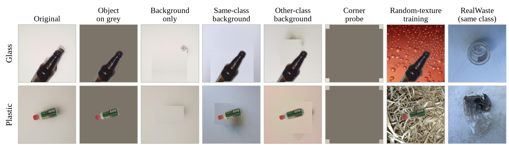

# How Much Does the Background Matter in Waste Classification? A Background-Swap Study on TrashNet with External Evaluation on RealWaste

Anirudh Sengar, Suleiman Altaf and Manar Alkhatib

Department of Computer Science, Faculty of Engineering and IT, The British University in Dubai, Dubai, United Arab Emirates

**Paper:** ICASF 2027 (to appear). A link will be added here on publication.

Code, frozen data splits, per-image predictions for every trained model and the scripts that regenerate every
table and figure in the paper.

## Summary

Waste classifiers trained on TrashNet are usually tested on photographs that share TrashNet's plain, class-specific
backgrounds. We measure how much two support vector machines (colour histogram, SIFT) and four ImageNet-pretrained
networks (partly frozen and fine-tuned ResNet-18, MobileNetV3-Large, Swin-T) rely on the background, using
background-only probes and edited test images built from published polygon masks (object on grey, background only,
object on a same-class or other-class background), with near-duplicate photographs kept on one side of a
group-aware split. We then test whether training with random textures, against a same-class paste control and a
shuffled-background control, improves accuracy on 3,587 RealWaste landfill photographs. Headline results:

- **Backgrounds alone predict the class.** A ResNet-18 trained and tested only on background-only images reached
  70.9% balanced accuracy, against 16.7% expected by chance (50.8% from the four 16 × 16-pixel corners alone).
- **Trained models use the background.** With the waste item held fixed, ResNet-18 was 9.0 percentage points less
  accurate on backgrounds from a different waste category than on same-category backgrounds (BG-GAP); training
  with random textures reduced this gap to 2.9 points.
- **Random textures help on landfill images.** ResNet-18 reached a RealWaste macro-F1 of 0.432 with random textures,
  compared with 0.383 using same-class background replacements and 0.336 with standard training.
- **The effect depends on the architecture.** Across the four networks, the change in RealWaste macro-F1 relative to
  standard training ranged from −0.024 to +0.096; Swin-T performed best on landfill images (0.542) and gained no
  benefit from random textures.



## Repository layout

| Path | Contents |
|---|---|
| `src/common.py`, `features.py`, `regimes.py`, `stats.py`, `testsets.py` | Shared paths and image helpers, colour and SIFT features, training regimes, statistics (metrics, duplicate-group bootstrap, permutation and sign-flip tests, Holm), evaluation sets |
| `src/s01_inventory.py` … `src/s05_variants6.py` | Data preparation: inventory and 224-pixel frames, duplicate audit, group-aware split, masks and eligibility, edited test images and probes |
| `src/s07_svm.py`, `src/s08_cnn.py` | Training: majority baseline and SVMs, neural networks (`s10` also trains: the duplicate-leakage check on the official split) |
| `src/s09_analysis.py`, `src/s10_leakage.py`, `src/s11_figures.py`, `src/s12_contrasts.py` | Analysis: every table and planned test, paper figures, regime contrasts and sorting-error analyses |
| `src/prepare.py` | Rebuilds and checksum-verifies the image arrays for the GPU stage; GPU smoke test |
| `scripts/download_data.sh` | Downloads all public inputs, checks SHA-256, extracts them |
| `scripts/reproduce_stats.sh`, `scripts/compare_results.py` | CPU-only regeneration of all tables and Figs 2-3 from the shipped predictions, with a comparison against the committed files |
| `scripts/run_all.sh`, `scripts/run_gpu.sh` | Full retraining from the raw data; resumable neural suite |
| `scripts/colab_install.sh`, `notebooks/colab_gpu.ipynb` | Environment set-up and notebook for running the neural suite on a Google Colab GPU |
| `configs/` | The two recorded judgement steps, made by an AI model (Claude) on label-hidden contact sheets: near-duplicate verdicts (`duplicate_review.csv`) and mask visual check (`mask_visual_check.csv`) |
| `data/hashes_sha256.txt` | SHA-256 of every downloaded file |
| `data/work/` | Small frozen tables: split, duplicate groups, manifests, eligibility, mask and polygon tables, edited-set metadata and pairings, sheet order of the mask visual check, packed U2-Net masks (`u2net_masks_packed.npy`, a 16 MB derived file that replaces the 1.5 h U2-Net pass; the only tracked file over 5 MB), array checksums |
| `results/` | Every table behind the paper (`*.csv`, `*.json`), per-image predictions (`preds/`, 143 files), training curves (`logs/`, 96 files), Figs 1-3 (`figures/`); see [`results/README.md`](results/README.md) |

Stage numbers follow the order of the original pipeline; there is no `s06` (a stage not used in the paper was
removed).

## Installation

Python 3.12 (tested with 3.12.14 on Linux). The pinned versions are in `requirements.txt`.

```bash
python3.12 -m venv .venv && source .venv/bin/activate
# CPU only (enough for the statistics and Figs 2-3):
pip install -r requirements.txt --extra-index-url https://download.pytorch.org/whl/cpu
# CUDA machine (retraining): torch 2.15.0 / torchvision 0.29.2 from PyPI are CUDA builds
pip install -r requirements.txt
```

The paper's statistics were computed with `torch 2.15.0+cpu`; the neural networks were trained with
`torch 2.15.0+cu132` on a Tesla T4 (per-run device and versions are in `results/nn_runs.csv`).

Hardware used:

| Route | Machine | Peak memory | Disk |
|---|---|---|---|
| A (statistics from the shipped predictions) | 13th Gen Intel Core i5-1334U (12 threads), 32 GB RAM | about 0.3 GB (`s09` 0.28 GB, `s12` 0.30 GB, figures 0.16 GB) | the clone only (about 100 MB) |
| B, CPU stages (`s01`-`s07`, `s09`-`s12`) | same laptop | not measured (image arrays are memory-mapped) | `data/raw` 1.5 GB, `data/ext` 1.4 GB, `data/work` about 5 GB after all stages |
| B, neural suite (`run_gpu.sh`) | Google Colab, Tesla T4 runtime | not measured; fits the standard Colab T4 runtime | as for the CPU stages |

## Data

No dataset images are redistributed. `scripts/download_data.sh` downloads every input into `data/raw/`, checks it
against `data/hashes_sha256.txt` and extracts it into `data/ext/` (about 1.6 GB downloaded, 1.4 GB extracted):

```bash
bash scripts/download_data.sh            # SKIP_U2NET=1 skips u2net.onnx; RAW_DIR=... reuses local copies
```

| File in `data/raw/` | Source | Licence |
|---|---|---|
| `trashnet.zip` | TrashNet (Yang & Thung, 2016), https://github.com/garythung/trashnet | MIT |
| `official_{train,val,test}.txt` | TrashNet official file-level split, same repository | MIT |
| `realwaste.zip` | RealWaste (Single et al., 2023), UCI Machine Learning Repository, https://doi.org/10.24432/C5SS4G | CC BY 4.0 |
| `trashnet-seg.zip` | TrashNet polygon re-annotation (Rohit, Tabassum & Raihan, 2026), Mendeley Data, https://doi.org/10.17632/f6y37w8hxb.1 | CC BY 4.0 |
| `dtd-r1.0.1.tar.gz` | Describable Textures Dataset (Cimpoi et al., 2014), https://www.robots.ox.ac.uk/~vgg/data/dtd/ | Research use only |
| `u2net.onnx` | U2-Net weights as released with rembg, https://github.com/danielgatis/rembg | Apache-2.0 |
| `prayitno/tn_index.csv`, `prayitno/tn_groups.npy` | TrashNet duplicate groups of Prayitno & Putra (2026), https://github.com/kang-prayit/n1-trustworthy-waste-classification (pinned commit), https://doi.org/10.5281/zenodo.23696855 | MIT |

The tables in `data/work/` contain file names, labels, hashes, group ids and masks derived from these datasets and
carry the attribution requirements of their sources.

## Reproducing the results

### A. Statistics and figures from the shipped predictions (CPU, no datasets)

Every table, planned test and Figs 2-3 can be regenerated from the per-image predictions in `results/preds/`:

```bash
bash scripts/reproduce_stats.sh
```

Without an activated virtual environment, name the interpreter: `PYTHON=.venv/bin/python bash scripts/reproduce_stats.sh`.

The script copies the shipped tables aside, runs `python -m src.s09_analysis`, `python -m src.s12_contrasts` and
`python -m src.s11_figures fig2 fig3`, overwriting the files in `results/`, and then `scripts/compare_results.py`,
which checks the regenerated tables against the copies (relative tolerance 1e-9). This works the same in a git clone
and in a downloaded archive. All bootstrap and permutation seeds are fixed, so the regenerated values agree with the
shipped ones to within this tolerance. Expected runtime on the laptop above: about 12 min for `s09` (bootstraps and
permutation tests over every model, regime and seed), about 3 min for `s12` and a few seconds for the figures.

Fig. 1 shows image crops and needs the prepared arrays (route B or `python -m src.prepare prepare`); afterwards
`python -m src.s11_figures fig1` rebuilds it.

### B. Full retraining from the raw data

```bash
bash scripts/download_data.sh
rm results/preds/{cnn,resnet18_ft,mobilenet_v3,swin_t}_*.npz results/rq4.json   # otherwise run_gpu.sh skips them
bash scripts/run_all.sh
```

`run_all.sh` runs every stage in order (`s01` … `s05_variants6`, `s07`, `scripts/run_gpu.sh`, `s09`, `s12`, `s11`).
The two judgement steps (verdicts on near-duplicate candidates and a label-blind visual check of test masks) were
made by an AI model (Claude) viewing the contact sheets with labels hidden; the verdicts, rater and date are
recorded in `configs/`, so the stages run unattended. Retrained neural runs, including the four-class `cnn` runs,
are all recorded in `results/nn_runs.csv` (`s08_version` v2). Approximate runtimes:

| Stage | Hardware | Time |
|---|---|---|
| `s01`-`s03` inventory, duplicate audit, split | 12-thread laptop CPU | ~15 min |
| `s04 u2net` U2-Net saliency for 2,527 images | laptop CPU | ~1.5 h |
| `s04 evaluate/sheets/finalize`, `s05_variants`, `s05_variants6` | laptop CPU | ~5 min |
| `s07` majority baseline and SVMs (all regimes, three paste draws, probes) | laptop CPU | under 1 h |
| `scripts/run_gpu.sh`: 96 neural runs and `s10` | Tesla T4 GPU | ~2.5 h of training (Swin-T ~1.3 h of it); ~3 h on Colab including installation and data download |
| `s09`, `s12`, `s11` | laptop CPU | ~15 min |

**Neural suite on Google Colab.** Open `notebooks/colab_gpu.ipynb` in Colab with a T4 runtime and run all cells. It
clones this repository, installs the pinned packages (`scripts/colab_install.sh`), downloads the data, rebuilds the
image arrays with `python -m src.prepare prepare` (which uses the packed U2-Net masks in `data/work/` instead of the
1.5 h U2-Net pass and must end with `checksums: ALL MATCH`), runs a smoke test, then `scripts/run_gpu.sh`, and
downloads the new predictions as a zip. Unzip it in the repository root and run route A.

**Determinism.** All randomness is seeded: split (`random_state=0`), SIFT codebook (seed 0), edited-image pairings
(seeds 0-4), SVM paste draws (0-2), network seeds (0-2) and every bootstrap. Retrained networks can still differ
in the last digits across GPUs, drivers and library versions because some CUDA kernels are not bit-reproducible,
and U2-Net saliency from onnxruntime can differ slightly across CPUs. The statistics in route A are exact.

**Two revisions of `s08_cnn.py`.** `results/nn_runs.csv` records one row per shipped network run, with the
training-script revision in `s08_version`. Twelve runs, the four-class runs of the partly frozen ResNet-18 (`paste`,
`rand`, `probe_bg`, `probe_fixed`, three seeds each), come from revision v1; all 84 others, including every run behind
the paper, come from the current revision v2. Both use the same model, optimiser, learning rates, weight decay,
batch size, early stopping and class weights. v1 differed in three ways: it trained and predicted in full FP32
precision (v2 uses mixed precision on CUDA); it drew a separate random resized crop and flip for each image (v2 draws
one crop and flip per mini-batch, see Training details); and it predicted in batches of 128 rather than 256. v1 files hold
only the four-class evaluation sets (no `var6_*` keys). The v1 runs feed only the supplementary four-class results. Rerunning `scripts/run_gpu.sh` retrains them with v2.

### Training details

All networks: ImageNet-pretrained weights, new six-way linear head, AdamW, batch size 32, at most 30 epochs, early
stopping on validation macro-F1 with patience 5 (the best epoch is kept), class-weighted cross-entropy (weights
n / (6 n<sub>c</sub>)), automatic mixed precision on CUDA. Augmentation after the regime's compositing:
`RandomResizedCrop(224, scale=(0.7, 1.0))` and horizontal flip, applied with one draw per mini-batch. Paste regimes
replace the background of an eligible training image with probability 0.5; T-jitter applies colour jitter
(brightness, contrast, saturation 0.4, hue 0.1) with probability 0.5. Validation: TrashNet validation split
(background-only or corner validation images for the probes). The logged `last_batch_loss` in `results/logs/` is the
loss of the last mini-batch of each epoch, not the epoch mean.

Eligibility criteria (`src/s05_variants6.py`). Edited test images and background donors: a usable, not whole-frame
polygon covering 2–75% of the 224 × 224 frame, at most 25% of the object lost to the square crop, and a background
strip of at least 8 pixels around the dilated object box (258 edited test images). Paste regimes: a usable polygon
covering 2–95% of the frame (1,519 of 1,766 training images). Corner probe: the four 16 × 16-pixel corners of images
whose polygon, dilated by 4 pixels, touches no corner (810, 182 and 194 training, validation and test images).

| Network (`arch`) | Trained layers | Learning rates (AdamW) | Weight decay | Schedule |
|---|---|---|---|---|
| ResNet-18, partly frozen (`cnn`) | layer4 and head (conv1-layer3 frozen, BN statistics fixed) | layer4 3e-4, head 1e-3 | 1e-4 | constant |
| ResNet-18, fine-tuned (`resnet18_ft`) | all | conv1-layer3 1e-4, layer4 3e-4, head 1e-3 | 1e-4 | cosine to 1e-5 over 30 epochs |
| MobileNetV3-Large (`mobilenet_v3`) | all | features 2e-4, classifier 1e-3 | 1e-4 | cosine to 1e-5 over 30 epochs |
| Swin-T (`swin_t`) | all | backbone 1e-4, head 5e-4 | 1e-2 | cosine to 1e-5 over 30 epochs |

SVMs (`s07`): RBF kernel, balanced class weights, C in {0.1, 1, 10, 100} × γ in {scale, 1e-3, 1e-2, 0.1}, chosen
on validation macro-F1 (`results/svm_tuning.csv`). Colour feature: 8 × 8 × 8 HSV histogram of the whole frame; SIFT
feature: 200-word bag of visual words (codebook fitted on at most 100,000 descriptors of T-orig training images,
seed 0). Augmented regimes add one composited copy of every eligible training image, for three paste draws.

## Paper tables and figures

| Paper item | Script | Output file(s) |
|---|---|---|
| Section 2.1 data, duplicates, split | `s01`, `s02`, `s03`; `s12` (RealWaste duplicates) | `results/counts.csv`, `duplicate_audit.csv`, `split_counts.csv`, `contrasts.json` (`realwaste_duplicates`) |
| Section 2.2 edited images and probes | `s05_variants6` | `results/variants6_info.json`, `eligibility6_counts.csv`; `exclusion_reasons.csv` (`s12`) |
| Section 2.3 SVM hyperparameters | `s07` | `results/svm_tuning.csv`, `m0.json` |
| Table 1 (macro-F1 by model and regime) | `s09` | `results/performance.csv`, `performance_seed_stats.csv` |
| Section 3.1 official-split leakage | `s10` | `results/rq4.csv`, `rq4.json` |
| Section 3.2 background-only probes (H1) | `s09` | `results/probes.csv`, `summary.json` |
| Table 2, Section 3.3 (accuracy on edited images, BG-GAP, H2) | `s09` | `results/reliance6.csv`, `reliance6_per_class.csv`, `summary.json` |
| Sections 3.4-3.6 regime contrasts (H3, H3b), seed variability | `s12` | `results/regime_contrasts.csv`, `seed_variability.csv` |
| Section 3.7 sorting errors and costs | `s09`, `s12` | `results/error_modes.csv`, `sorting_errors.csv`, `error_cost.csv` |
| Section 4.2 stricter eligibility, class balancing | `s12` | `results/bggap_sensitivity.csv`, `exclusion_reasons.csv` |
| Planned tests with Holm-adjusted p-values | `s09` | `results/summary.json` (`planned_tests`: H1, H2, H3) |
| Fig. 1 | `s11_figures fig1` | `results/figures/icasf_fig1_protocol.png` |
| Fig. 2 | `s11_figures fig2` (from `probes.csv`, `reliance6.csv`) | `results/figures/icasf_fig2_shortcuts.png` |
| Fig. 3 | `s11_figures fig3` (from `performance.csv`, `confusion_matrices.npy`) | `results/figures/icasf_fig3_transfer.png` |

The `regime` column of every table uses the paper's names. In file names and on the command line the regimes are
`orig` = T-orig, `jitter` = T-jitter, `paste6` = T-paste, `shuffle6` = T-shuffle, `rand6` = T-rand. The four-class
U2-Net suite (regimes `paste` = `T-paste-U2Net (suppl.)` and `rand` = `T-rand-U2Net (suppl.)`, `var_*` sets,
`reliance.csv`, `summary.json` key `supplementary_u2net`) is supplementary and is not reported in the paper; it is
kept because `s09` reports it alongside the six-class suite.

## Citation

```bibtex
@inproceedings{sengar2027background,
  title     = {How Much Does the Background Matter in Waste Classification? A Background-Swap Study on TrashNet with External Evaluation on RealWaste},
  author    = {Sengar, Anirudh and Altaf, Suleiman and Alkhatib, Manar},
  booktitle = {ICASF 2027},
  year      = {2027},
  note      = {To appear}
}
```

Machine-readable metadata are in [`CITATION.cff`](CITATION.cff).

## Licence

The code and the result files are released under the MIT licence ([`LICENSE`](LICENSE)). The datasets keep their
own licences (see [Data](#data)); in particular, the Describable Textures Dataset is for research use only.

## Contact

Anirudh Sengar (corresponding author), 23001546@ug.buid.ac.ae, or open an issue on the repository.
